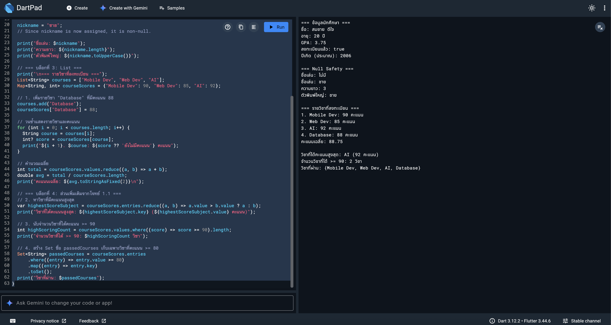
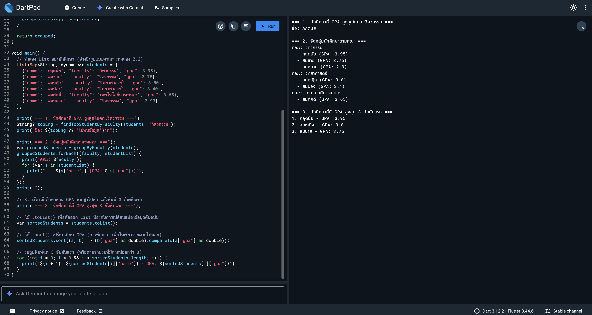
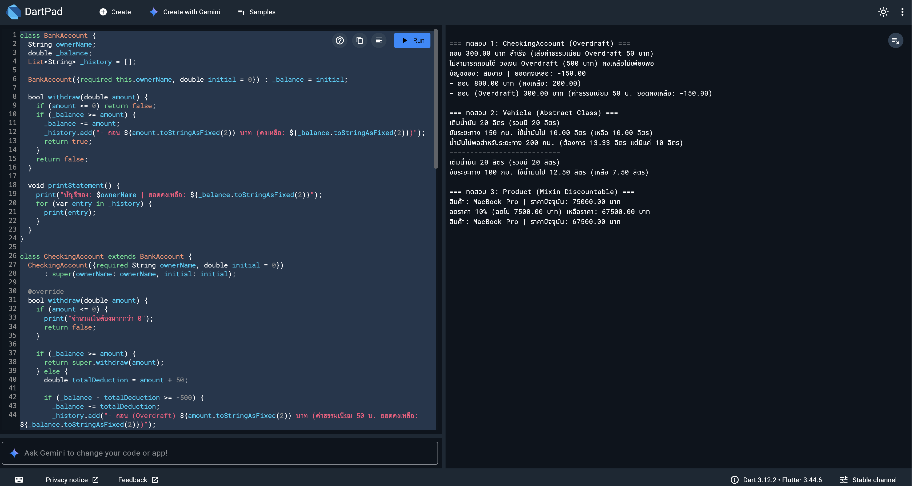
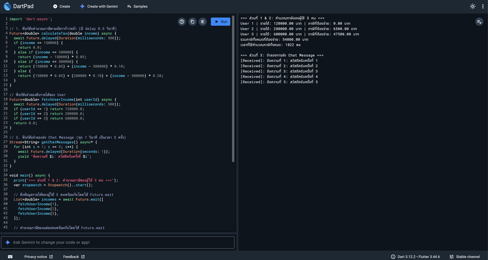

# MDSD - Week 2 Lab Sheet 2-1: Dart Programming Fundamentals

67030011 Krittanai

---

## โครงสร้างโปรเจกต์

- [week02_lab2-1.md](file:///Users/kbbk/MDAD/MDSD-Week2-LabSheet2-1-2026/week02_lab2-1.md) - เอกสารโจทย์หลักและบันทึกผลการทดลอง
- [images/](file:///Users/kbbk/MDAD/MDSD-Week2-LabSheet2-1-2026/images/) - โฟลเดอร์เก็บภาพผลลัพธ์การรันโปรแกรม

---

## บันทึกผลงานการทดลองและซอร์สโค้ด

### ส่วนที่ 1: Variables, Types และ Null Safety

แก้โจทย์การคำนวณคะแนนเฉลี่ย, หาวิชาที่ได้คะแนนสูงสุด, นับจำนวนวิชาที่ได้คะแนนมากกว่าหรือเท่ากับ 90 คะแนน และจัดเก็บวิชาที่ผ่าน (คะแนน >= 80) ลงใน Set

#### โค้ดที่ได้

```dart
void main() {
  // === บล็อกที่ 1: ชนิดข้อมูลพื้นฐาน ===
  String studentName = "สมชาย ดีใจ";
  int studentAge = 20;
  double gpa = 3.75;
  bool isEnrolled = true;

  print("=== ข้อมูลนักศึกษา ===");
  print("ชื่อ: $studentName");
  print("อายุ: $studentAge ปี");
  print("GPA: $gpa");
  print("ลงทะเบียนแล้ว: $isEnrolled");
  print("ปีเกิด (ประมาณ): ${2026 - studentAge}");

  // === บล็อกที่ 2: Null Safety ===
  print("\n=== Null Safety ===");
  String? nickname = null;
  print("ชื่อเล่น: ${nickname ?? 'ไม่มี'}");

  nickname = "ชาย";

  print("ชื่อเล่น: $nickname");
  print("ความยาว: ${nickname.length}");
  print("ตัวพิมพ์ใหญ่: ${nickname.toUpperCase()}");
  
  // === บล็อกที่ 3: List ===
  print("\n=== รายวิชาที่ลงทะเบียน ===");
  List<String> courses = ["Mobile Dev", "Web Dev", "AI"];
  Map<String, int> courseScores = {"Mobile Dev": 90, "Web Dev": 85, "AI": 92};

  // 1. เพิ่มรายวิชา "Database" ที่มีคะแนน 88
  courses.add("Database");
  courseScores["Database"] = 88;

  // วนซ้ำแสดงรายวิชาและคะแนน
  for (int i = 0; i < courses.length; i++) {
    String course = courses[i];
    int? score = courseScores[course];
    print("${i + 1}. $course: ${score ?? 'ยังไม่มีคะแนน'} คะแนน");
  }

  // คำนวณเฉลี่ย
  int total = courseScores.values.reduce((a, b) => a + b);
  double avg = total / courseScores.length;
  print("คะแนนเฉลี่ย: ${avg.toStringAsFixed(2)}\n");

  // === บล็อกที่ 4: ส่วนเพิ่มเติมจากโจทย์ 1.1 ===
  // 2. หาวิชาที่มีคะแนนสูงสุด
  var highestScoreSubject = courseScores.entries.reduce((a, b) => a.value > b.value ? a : b);
  print("วิชาที่ได้คะแนนสูงสุด: ${highestScoreSubject.key} (${highestScoreSubject.value} คะแนน)");

  // 3. นับจำนวนวิชาที่ได้คะแนน >= 90
  int highScoringCount = courseScores.values.where((score) => score >= 90).length;
  print("จำนวนวิชาที่ได้ >= 90: $highScoringCount วิชา");

  // 4. สร้าง Set ชื่อ passedCourses เก็บเฉพาะวิชาที่คะแนน >= 80
  Set<String> passedCourses = courseScores.entries
      .where((entry) => entry.value >= 80)
      .map((entry) => entry.key)
      .toSet();
  print("วิชาที่ผ่าน: $passedCourses");
}
```

#### ผลลัพธ์การรันโปรแกรม



---

### ส่วนที่ 2: Functions

แก้โจทย์การเขียนฟังก์ชันเพื่อค้นหาท็อปสตาฟในคณะ (`findTopStudentByFaculty`), จัดกลุ่มนักศึกษาตามคณะ (`groupByFaculty`) และการใช้ `sort()` จัดอันดับ GPA ของนักศึกษา

#### โค้ดที่ได้

```dart
String? findTopStudentByFaculty(List<Map<String, dynamic>> students, String faculty) {
  var facultyStudents = students.where((s) => s["faculty"] == faculty);
  if (facultyStudents.isEmpty) return null;
  var topStudent = facultyStudents.reduce((a, b) => (a["gpa"] as double) > (b["gpa"] as double) ? a : b);
  return topStudent["name"];
}

Map<String, List<Map<String, dynamic>>> groupByFaculty(List<Map<String, dynamic>> students) {
  Map<String, List<Map<String, dynamic>>> grouped = {};
  for (var student in students) {
    String faculty = student["faculty"];
    if (!grouped.containsKey(faculty)) {
      grouped[faculty] = [];
    }
    grouped[faculty]!.add(student);
  }
  return grouped;
}

void main() {
  List<Map<String, dynamic>> students = [
    {"name": "กฤตนัย", "faculty": "วิศวกรรม", "gpa": 3.95},
    {"name": "สมชาย", "faculty": "วิศวกรรม", "gpa": 3.75},
    {"name": "สมหญิง", "faculty": "วิทยาศาสตร์", "gpa": 3.80},
    {"name": "สมปอง", "faculty": "วิทยาศาสตร์", "gpa": 3.40},
    {"name": "สมศักดิ์", "faculty": "เทคโนโลยีการเกษตร", "gpa": 3.65},
    {"name": "สมหมาย", "faculty": "วิศวกรรม", "gpa": 2.90},
  ];

  print("=== 1. นักศึกษาที่ GPA สูงสุดในคณะวิศวกรรม ===");
  String? topEng = findTopStudentByFaculty(students, "วิศวกรรม");
  print("ชื่อ: ${topEng ?? 'ไม่พบข้อมูล'}\n");

  print("=== 2. จัดกลุ่มนักศึกษาตามคณะ ===");
  var groupedStudents = groupByFaculty(students);
  groupedStudents.forEach((faculty, studentList) {
    print("คณะ: $faculty");
    for (var s in studentList) {
      print("  - ${s["name"]} (GPA: ${s["gpa"]})");
    }
  });
  print("");

  print("=== 3. นักศึกษาที่มี GPA สูงสุด 3 อันดับแรก ===");
  var sortedStudents = students.toList();
  sortedStudents.sort((a, b) => (b["gpa"] as double).compareTo(a["gpa"] as double));

  for (int i = 0; i < 3 && i < sortedStudents.length; i++) {
    print("${i + 1}. ${sortedStudents[i]["name"]} - GPA: ${sortedStudents[i]["gpa"]}");
  }
}
```

#### ผลลัพธ์การรันโปรแกรม



---

### ส่วนที่ 3: Object-Oriented Programming (OOP)

พัฒนาโครงสร้างคลาส `BankAccount`, `CheckingAccount` ที่อนุญาตให้ทำ Overdraft และคำนวณการใช้น้ำมันผ่าน Abstract Class `Vehicle` รวมถึงการแชร์ความสามารถลดราคาให้แก่ `Product` ด้วย Mixin `Discountable`

#### โค้ดที่ได้

```dart
class BankAccount {
  String ownerName;
  double _balance;
  List<String> _history = [];

  BankAccount({required this.ownerName, double initial = 0}) : _balance = initial;

  bool withdraw(double amount) {
    if (amount <= 0) return false;
    if (_balance >= amount) {
      _balance -= amount;
      _history.add("- ถอน ${amount.toStringAsFixed(2)} บาท (คงเหลือ: ${_balance.toStringAsFixed(2)})");
      return true;
    }
    return false;
  }

  void printStatement() {
    print("บัญชีของ: $ownerName | ยอดคงเหลือ: ${_balance.toStringAsFixed(2)}");
    for (var entry in _history) {
      print(entry);
    }
  }
}

class CheckingAccount extends BankAccount {
  CheckingAccount({required String ownerName, double initial = 0})
      : super(ownerName: ownerName, initial: initial);

  @override
  bool withdraw(double amount) {
    if (amount <= 0) {
      print("จำนวนเงินต้องมากกว่า 0");
      return false;
    }

    if (_balance >= amount) {
      return super.withdraw(amount);
    } else {
      double totalDeduction = amount + 50;
      
      if (_balance - totalDeduction >= -500) {
        _balance -= totalDeduction;
        _history.add("- ถอน (Overdraft) ${amount.toStringAsFixed(2)} บาท (ค่าธรรมเนียม 50 บ. ยอดคงเหลือ: ${_balance.toStringAsFixed(2)})");
        print("ถอน ${amount.toStringAsFixed(2)} บาท สำเร็จ (เสียค่าธรรมเนียม Overdraft 50 บาท)");
        return true;
      } else {
        print("ไม่สามารถถอนได้ วงเงิน Overdraft (500 บาท) คงเหลือไม่เพียงพอ");
        return false;
      }
    }
  }
}

abstract class Vehicle {
  double fuel = 0;

  double get fuelEfficiency;

  void refuel(double liters) {
    fuel += liters;
    print("เติมน้ำมัน $liters ลิตร (รวมมี $fuel ลิตร)");
  }

  void drive(double km) {
    double fuelNeeded = km / fuelEfficiency;
    if (fuel >= fuelNeeded) {
      fuel -= fuelNeeded;
      print("ขับระยะทาง $km กม. ใช้น้ำมันไป ${fuelNeeded.toStringAsFixed(2)} ลิตร (เหลือ ${fuel.toStringAsFixed(2)} ลิตร)");
    } else {
      print("น้ำมันไม่พอสำหรับระยะทาง $km กม. (ต้องการ ${fuelNeeded.toStringAsFixed(2)} ลิตร แต่มีแค่ $fuel ลิตร)");
    }
  }
}

class Car extends Vehicle {
  @override
  double get fuelEfficiency => 15.0;
}

class Truck extends Vehicle {
  @override
  double get fuelEfficiency => 8.0;
}

mixin Discountable {
  double price = 0;

  void applyDiscount(double percent) {
    double discountAmount = price * (percent / 100);
    price -= discountAmount;
    print("ลดราคา $percent% (ลดไป ${discountAmount.toStringAsFixed(2)} บาท) เหลือราคา: ${price.toStringAsFixed(2)} บาท");
  }
}

class Product with Discountable {
  String name;

  Product({required this.name, required double initialPrice}) {
    this.price = initialPrice;
  }

  void showProduct() {
    print("สินค้า: $name | ราคาปัจจุบัน: ${price.toStringAsFixed(2)} บาท");
  }
}

void main() {
  print("\n=== ทดสอบ 1: CheckingAccount (Overdraft) ===");
  var checking = CheckingAccount(ownerName: "สมชาย", initial: 1000);
  checking.withdraw(800);
  checking.withdraw(300);
  checking.withdraw(400);
  checking.printStatement();

  print("\n=== ทดสอบ 2: Vehicle (Abstract Class) ===");
  Vehicle myCar = Car();
  myCar.refuel(20);
  myCar.drive(150);
  myCar.drive(200);

  print("---------------------------");
  Vehicle myTruck = Truck();
  myTruck.refuel(20);
  myTruck.drive(100);

  print("\n=== ทดสอบ 3: Product (Mixin Discountable) ===");
  var laptop = Product(name: "MacBook Pro", initialPrice: 75000);
  laptop.showProduct();
  laptop.applyDiscount(10);
  laptop.showProduct();
}
```

#### ผลลัพธ์การรันโปรแกรม



---

### ส่วนที่ 4: Asynchronous Programming

พัฒนาโปรแกรมคำนวณภาษีเงินได้อัตราก้าวหน้าของผู้ใช้ 3 คนในเวลาเดียวกันแบบขนานโดยใช้ `Future.wait` และพัฒนาฟังก์ชัน Stream เพื่อคอยรับส่งข้อมูลข้อความแชททีละวินาที

#### โค้ดที่ได้

```dart
import 'dart:async';

Future<double> calculateTax(double income) async {
  await Future.delayed(Duration(milliseconds: 500));
  if (income <= 150000) {
    return 0.0;
  } else if (income <= 300000) {
    return (income - 150000) * 0.05;
  } else if (income <= 500000) {
    return (150000 * 0.05) + (income - 300000) * 0.10;
  } else {
    return (150000 * 0.05) + (200000 * 0.10) + (income - 500000) * 0.20;
  }
}

Future<double> fetchUserIncome(int userId) async {
  await Future.delayed(Duration(milliseconds: 500));
  if (userId == 1) return 120000.0;
  if (userId == 2) return 280000.0;
  if (userId == 3) return 600000.0;
  return 0.0;
}

Stream<String> getChatMessages() async* {
  for (int i = 1; i <= 5; i++) {
    await Future.delayed(Duration(seconds: 1));
    yield "ข้อความที่ $i: สวัสดีครับครั้งที่ $i";
  }
}

void main() async {
  print("=== ส่วนที่ 1 & 2: คำนวณภาษีของผู้ใช้ 3 คน ===");
  var stopwatch = Stopwatch()..start();

  List<double> incomes = await Future.wait([
    fetchUserIncome(1),
    fetchUserIncome(2),
    fetchUserIncome(3),
  ]);

  List<double> taxes = await Future.wait([
    calculateTax(incomes[0]),
    calculateTax(incomes[1]),
    calculateTax(incomes[2]),
  ]);

  double totalTax = 0.0;
  for (int i = 0; i < incomes.length; i++) {
    print("User ${i + 1} | รายได้: ${incomes[i].toStringAsFixed(2)} บาท | ภาษีที่ต้องจ่าย: ${taxes[i].toStringAsFixed(2)} บาท");
    totalTax += taxes[i];
  }
  print("รวมภาษีทั้งหมดที่ต้องจ่าย: ${totalTax.toStringAsFixed(2)} บาท");
  print("เวลาที่ใช้คำนวณภาษีทั้งหมด: ${stopwatch.elapsedMilliseconds} ms\n");

  print("=== ส่วนที่ 3: จำลองการส่ง Chat Message ===");
  await for (var message in getChatMessages()) {
    print("[Received]: $message");
  }
}
```

#### บันทึกผลเปรียบเทียบเวลา (การทดลอง 4.1)

- Sequential (รันทีละงาน): ใช้เวลา 3547 ms
- Parallel (Future.wait): ใช้เวลา 999 ms
- ประสิทธิภาพที่ได้: ประหยัดเวลาไปได้ 2548 ms (ทำงานเร็วขึ้นประมาณ 71.84%)

#### ผลลัพธ์การรันโปรแกรม



---

## คำถามท้ายใบงาน

### ข้อ 1 อธิบายความแตกต่างระหว่าง final และ const พร้อมยกตัวอย่างกรณีที่ใช้แต่ละแบบ

final ใช้กำหนดค่าคงที่ที่คำนวณตอนโปรแกรมทำงาน (Runtime) เช่น เวลาปัจจุบันหรือข้อมูลจาก API ส่วน const ต้องกำหนดค่าตั้งแต่ขั้นตอนเขียนโค้ด (Compile-time) และต้องคงที่ตายตัวเท่านั้น เช่น ค่าพาย 3.14

### ข้อ 2 Named Parameters และ Positional Parameters ต่างกันอย่างไร? ควรเลือกใช้แบบไหนเมื่อไหร่?

Positional parameters บังคับให้ส่งค่าตามลำดับตำแหน่งที่ประกาศ เหมาะกับฟังก์ชันที่มีพารามิเตอร์น้อย ส่วน Named parameters ส่งค่าผ่านการระบุชื่อโดยไม่ต้องเรียงลำดับ เหมาะกับฟังก์ชันที่มีการตั้งค่าเยอะเพื่อให้โค้ดอ่านง่ายขึ้น

### ข้อ 3 Abstract Class และ Mixin มีจุดประสงค์ต่างกันอย่างไร? ยกตัวอย่างสถานการณ์ที่เหมาะกับแต่ละแบบ

Abstract class ใช้เป็นโครงร่างหลักให้คลาสกลุ่มเดียวกันสืบทอด (เช่น Car และ Truck สืบทอดจาก Vehicle) ส่วน Mixin ใช้สำหรับแบ่งปันความสามารถเฉพาะทางให้กับหลายๆ คลาสได้โดยไม่ต้องผ่านระบบสืบทอดแบบคลาสปกติ

### ข้อ 4 จากการทดลอง 4.1 Sequential ใช้เวลาประมาณกี่ ms และ Parallel ใช้เวลาเท่าไหร่? อธิบายเหตุผลที่ Parallel เร็วกว่า และบอกกรณีที่ต้องใช้ Sequential แทน

Sequential ใช้เวลา 3547 ms ส่วน Parallel ใช้เวลา 999 ms ซึ่ง Parallel เร็วกว่าเพราะทำงานไปพร้อมกันแล้วรอเฉพาะตัวที่ช้าที่สุด ส่วน Sequential จะใช้เมื่อขั้นตอนถัดไปจำเป็นต้องใช้ผลลัพธ์จากขั้นตอนก่อนหน้าก่อน

### ข้อ 5 Future และ Stream ต่างกันอย่างไร? ยกตัวอย่างสถานการณ์ที่เหมาะกับแต่ละแบบจากการพัฒนา Mobile App จริงๆ

Future คืนค่าผลลัพธ์เพียงครั้งเดียวแล้วเสร็จสิ้นการทำงาน เช่น การดึงโปรไฟล์ผู้ใช้งาน ส่วน Stream จะทยอยส่งผลลัพธ์กลับมาเรื่อยๆ อย่างต่อเนื่อง เหมาะกับงานเรียลไทม์ เช่น การรับข้อความในห้องแชท หรือการดึงพิกัด GPS
